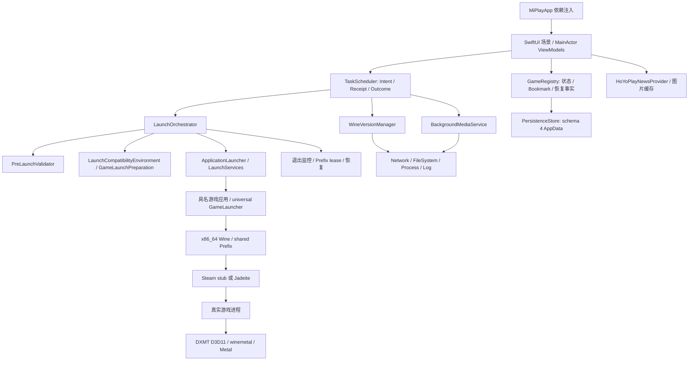

# MiPlay 系统架构

依据当前源码（冻结 HEAD 见 PROJECT_OVERVIEW），历史 ADR 作为理由来源；旧文档中的计划或已废弃描述不能覆盖现代码。

## 分层与调用关系

## 核心模块与状态所有权

| 模块 | 职责与关键接口 |
|---|---|
| LibraryViewModel / SettingsViewModel | Domain snapshot/event 到 UI 投影；启动准备遮罩、选择、设置、恢复请求，不将显示状态当作持久化事实 |
| GameRegistry / GameStateMachine | 注册/定位、安全 bookmark、业务状态转换、launch/exit 事实与恢复记录；`commitProcessExit`、`retryProcessExitRecovery` |
| TaskScheduler | 支持的任务白名单、去重、资源锁、取消、持久化 task history、Receipt/Outcome。当前支持 launch、solution apply/revert、version check、integrity、Wine setup、media load、log export；其它类型 fail closed |
| WineVersionManager | 固定 runtime 元数据来源、download/install/readiness 与共享 Prefix authoritative record |
| WineRuntimeProvider | Prefix 初始化/验证、注册表选项、lease 获取/释放及按管理范围关闭 wineserver |
| LaunchOrchestrator | scope、preflight、lease、staging、启动/监控、退出提交与恢复，不把 Wine/Steam 包装进程存活当成实机画面认证 |
| ApplicationLauncher / ProcessManager | 具名 .app 的 LaunchServices 生命周期和直接子进程路径；状态文件会话身份、stdout/stderr、取消/终止与等待 |
| BackgroundMediaService | 背景集合选择/指纹、下载和缓存、图像/视频转换、与 Wine 准备并行的 scheduler 任务 |
| HoYoPlayNewsProvider / NewsBannerImageCache | 官方 GET 数据解析、游戏身份校验、JSON/image 缓存、失败保留旧内容；ViewModel 防止旧请求覆盖新游戏 |
| SolutionEngine | 保留方案框架，`BuiltInSolutions.publishedSolutions()` 当前为空；不能把历史系统修改定义描述为可用功能 |
| LogWriter / PersistenceStore | 结构化日志与脱敏、schema 校验/迁移、原子写、备份/损坏数据保全、恢复事实 |

## 关键数据与存储

- `AppData.currentSchemaVersion = 4`：games、backgroundModes、performanceOptions、gameEnvironmentSettings、managedWineRuntime、sharedWinePrefix、taskHistory、recoveryRecords 等。旧 selectedWine* 字段是迁移输入，不是自由版本选择承诺。
- `GameLocation` 持久化 bookmark + lastKnownPath + resolutionState；lastKnownPath 不能代替授权。独立测试宿主须创建自己的 bookmark，不重写用户原应用授权。
- `ManagedWineRuntime` 与 `SharedWinePrefix` 记录绑定的单一环境；`SharedWinePrefixLease` 在启动会话内串行保护共享资源。直接变更 DLL/运行时会绕过管理记录与回滚语义。
- Receipt、ScheduledTaskRecord、Outcome、RecoveryRecord 区分请求、执行结果及待恢复事实；UI 接到 task complete 仍须读取 outcome。
- 默认持久化/受控文件根为 `~/Library/Application Support/MiPlay`；新闻缓存另位于系统 Caches 的 MiPlay/GameNews-v1。不要为迁移打开或复制凭据到版本库。

## 启动/退出数据流

1. UI 请求定位过的 Game；预检确认状态、bookmark、运行时/Prefix 可用、必要资源；取得共享 lease。
2. 按游戏 staging D3D11/dxgi/winemetal、兼容存根/Jadeite，必要时临时移开游戏 Vulkan loader；保持恢复记录。NVAPI/NGX opt-in，崩铁要求另见 profile。
3. 构造工作目录、Wine/图形/同步环境与 DLL override；三游戏使用各自同步配置，不一律合并开关。ProcessManager 精确剔除继承的 Metal validation 变量；DYLD_LIBRARY_PATH/DYLD_FRAMEWORK_PATH 未被证明是根因，当前并非全部清除。
4. 固定管理目录通常采用 LaunchServices 具名游戏 .app → universal GameLauncher → Wine；其他布局走直接 ProcessManager（必要时同 helper）。helper 可等待 wineserver，不能靠它存活证明真实游戏存活。
5. 运行监控唯一提交退出事实、停止 scope、释放 Prefix lease、恢复 staged 文件；主动取消等同一 monitor 完成，防止重复释放。
6. 最新 `b5ce2b6` 加 `sessionProcessExited`：确认进程退出后，即使 lease 清理失败也能会话内重试；先释放 lease，再消费恢复记录，清理/写失败保持可重试；进程未知或仍运行不得误杀。

## 外部接口与依赖

- Wine 元数据：固定 `yaagl/anime-game-wine` GitHub Release allowlist；无已批准第三方镜像。包含下载/重定向/布局/身份检查，不等同于 DSH 的 Ed25519 catalog 契约。
- 图标/背景/版本/新闻：官方米哈游/HoYoPlay HTTPS 数据。新闻调用 `hyp-api.mihoyo.com/hyp/hyp-connect/api/getGameContent`，按游戏 ID/biz 校验。
- DXMT：随包 Windows x86_64 DLL + x86_64 `winemetal.so`，Windows/Unix bridge 是私有版本耦合边界。固定源码基线与补丁/哈希见 RuntimeAssets/dxmt/ASSET_MANIFEST.json。
- FFmpeg 进程参数：CRF14/veryslow/yuv420p，保留源分辨率/帧率、无音频，600 秒超时；质量标记防旧缓存误用。
- 崩铁还调用 `beginStarRailNetworkWindow`：osascript 显示管理员授权提示，临时向 `/etc/hosts` 写入两条带会话标记的域名屏蔽行，设计为15秒后清除。迁移不调用；仅临时文件脚本测试，不代表真实授权/异常退出恢复已验证。这条实现与旧 ADR 的签名 helper 目标并不完全一致。
- Apple 系统 framework；未发现 MiPlay 与 DSH Runtime 的 RPC、共享数据库或 package 直接依赖。

## 构建与发布

Xcode scheme MiPlay；项目主应用目录同步纳入源码，测试文件仍需 project 配置。应用 Swift 5 语言模式，MainActor 默认边界；改为 Swift 6 时现有测试 Sendable 捕获存在已知构建缺口，不能声称完整 Swift 6 已支持。

运行时资源随 Xcode Resources 拷贝，GameLauncher 有源码与随包已编译文件两份；修改 C 源需重建 universal 文件并验证哈希/会话行为。DXMT 重建要求官方工具链、固定 base+patch、七件套同构建；Wine SDK v8.16-3shain 仅为编译 SDK，不是将实际 Wine 11.0 降级。

开发构建 `CODE_SIGNING_ALLOWED=NO` 只验证编译/测试；Developer ID、Hardened Runtime 对动态库加载、notarization、分发安装与升级配对需要独立发布验收。不存在本次迁移自动部署或升级行为。
